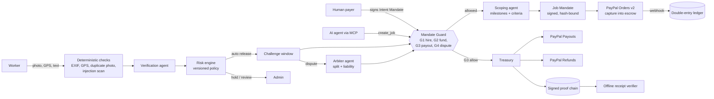

# SettleAI

**AI agents will hire people. SettleAI makes sure the work was done before PayPal pays, and says who is liable when it was not.**

> AP2-style mandates prove a human authorized an agent to pay. SettleAI adds what happens next for real-world
> services: the money waits in PayPal, proof is checked by rules and AI, a deterministic Mandate Guard decides every
> payout, disputes get a liability finding, and every step is a signed receipt anyone can verify offline.

Built for the **PayPal AI Hackathon 2026**. MIT licensed.

---

## Try it in two minutes (no keys needed)

```bash
pnpm install
pnpm db:reset      # embedded Postgres (PGlite) with two weeks of demo history
pnpm dev           # http://localhost:3000
```

Click **Payer**, **Worker** or **Admin** on the landing page; there are no sign-ups. With no keys, PayPal runs as a
clearly labelled mock and the AI agents run on an offline stub, so every journey works offline. The header badge always
says which mode is live.

| Journey | Where | What you will see |
|---|---|---|
| Hire and fund | Payer, **New job** | Describe a job in plain words; the scoping agent drafts paid milestones with proof requirements; fund through PayPal into escrow |
| Get paid | Worker, open the job, **Submit proof** | Use **Photo at the right place**; watch the live checks; after a short challenge window PayPal pays out |
| Fraud caught | Worker, **Photo reused from another job** | Held: "This photo was already submitted for another job". No money moves |
| Agent denied | Payer, **Agent mandates**, **Out of scope**, **Send as agent** | `MANDATE_SCOPE_VIOLATION`, `MANDATE_CAP_EXCEEDED`; nothing created |
| Dispute | Payer, **Dispute this milestone** in the challenge window | The arbiter splits the amount and names the fault class; PayPal pays and refunds |
| Revoke | Payer, **Revoke** a mandate during a challenge window | The payout pauses before any PayPal call; you choose to pay or refund |
| Verify | Any job, **Open the public receipt**, or **/verify** | All checks green; change one byte and it fails, pointing at the broken link |
| Operate | **Admin** | AG Grid console: KPIs, review queue, disputes, ledger, guard checks, AI runs, evaluation, risk policy |

### Real AI agents (MCP)

```bash
pnpm dev                 # terminal 1
pnpm procurebot          # terminal 2: an agent hires through the MCP server; one request is denied, one is created
```

Any MCP client can connect; see [src/mcp/README.md](src/mcp/README.md). Agents can create and track jobs but can never
fund or pay.

### Live mode (optional)

```bash
# .env.local
XAI_API_KEY=...            # xAI Grok for the scoping, verification and arbiter agents (and ProcureBot live mode)
PAYPAL_CLIENT_ID=...       # PayPal sandbox: switches payments to LIVE (sandbox)
PAYPAL_CLIENT_SECRET=...
PAYPAL_WEBHOOK_ID=...
```

---

## How it works



**LLMs propose. Policy decides. The ledger records. PayPal moves money.** No AI agent has a tool that moves funds; only
the deterministic Treasury calls PayPal, and only after the Mandate Guard allows it.

### How PayPal is used

- **Orders v2** (create, capture) funds escrow; the job is funded only when the `PAYMENT.CAPTURE.COMPLETED` webhook confirms it.
- **Payouts v1** pays each milestone after verification and the challenge window.
- **Payments v2 refunds** return the payer's share in disputes and cancellations, including the unearned platform fee.
- **Webhooks** with signature verification, event-id dedupe and state-machine-safe handlers; a reconciliation job compares records with PayPal.
- The **Payment Mandate's hash is bound into the order's `custom_id`**.
- Every endpoint, field limit and status enum was checked against PayPal's official OpenAPI specs; see [docs/paypal-notes.md](docs/paypal-notes.md).

### How AI is used

| Agent | Job | Guardrails |
|---|---|---|
| Scoping | Plain words to milestones with machine-checkable acceptance criteria | Never invents amounts (a stated budget must match exactly); prohibited-content flags |
| Verification (vision) | Judges each AI-checked criterion from photos and text | Rule checks run first and always win; injected instructions are removed and force human review |
| Arbiter | Proposes a dispute split and a fault class with its basis | Release + refund must equal the disputed amount (enforced in code); the mandate-compliance report is ground truth |
| ProcureBot (reference agent) | Hires through the MCP server | Bound by its signed mandate; cannot fund or pay |

All agent output is Zod-validated, retried once with the error, then falls back to a person. Every run is traced
(model, prompt version, tokens, latency) in **Admin > AI runs**.

## Evidence it works

`pnpm eval` runs the spec's 30 scenarios through the real services ([eval/report.json](eval/report.json), also at **Admin > Evaluation**):

| Metric | Result |
|---|---|
| Scenarios passed | 28 / 28 (2 skipped: file-upload proofs are not built yet) |
| Bad proofs paid automatically | **0%** |
| Out-of-mandate agent requests allowed | **0%** |
| Receipt tampering detected | **100%** (49 / 49 single-field changes) |
| Prompt injection detected | **100%** |
| Dispute splits that did not add up | **0** |

Plus 132 unit and integration tests, 10 Playwright journeys (including a WCAG AA audit and a phone-sized run),
failure drills (webhook storms, PayPal outage, LLM outage, database restart), and `pnpm demo:smoke`.

```bash
pnpm test        # unit + integration
pnpm e2e         # browser journeys
pnpm eval        # scenario evaluation
pnpm demo:smoke  # end-to-end money paths
pnpm verify-receipt receipt.json --platform-keys keys.json   # offline receipt check
```

## Honest positioning

- Everything runs on the **PayPal sandbox or a labelled mock**, with test money only.
- SettleAI mandates are **AP2-inspired** and extend the idea to conditional settlement and liability. They are not
  official AP2 and not endorsed by PayPal or Google. See [docs/AP2-EXTENSION.md](docs/AP2-EXTENSION.md) for the mapping and the differences.
- PayPal has no native escrow here; SettleAI uses a **ledgered hold**: capture to the platform account, release by Payouts.
- Demo logins let anyone act as payer, worker or admin. Demo signing keys are held by SettleAI (encrypted at rest);
  production would use passkeys or a KMS/HSM.
- A production system holding customer funds needs licensing or a regulated partner and a third-party security review.
  See [docs/SECURITY-REVIEW.md](docs/SECURITY-REVIEW.md).

## Repository map

| Path | What |
|---|---|
| `src/core/services` | Jobs, funding, treasury, ledger, verification, releases, disputes, mandates, Mandate Guard, receipts |
| `src/core/agents` | Scoping, verification and arbiter agents (prompts, schemas, offline stubs) |
| `src/core/mandates`, `src/core/verifier` | Canonical JSON, ES256 JWS, proof chain, offline receipt verifier |
| `src/core/adapters` | PayPal (live REST + mock), xAI Grok, storage |
| `src/mcp` | MCP server for external agents |
| `src/app` | Next.js pages and API routes |
| `eval`, `tests` | Scenario evaluation, unit, integration and Playwright tests |
| `docs` | Spec, status, PayPal notes, AP2 mapping, security review |

## License

[MIT](LICENSE)
