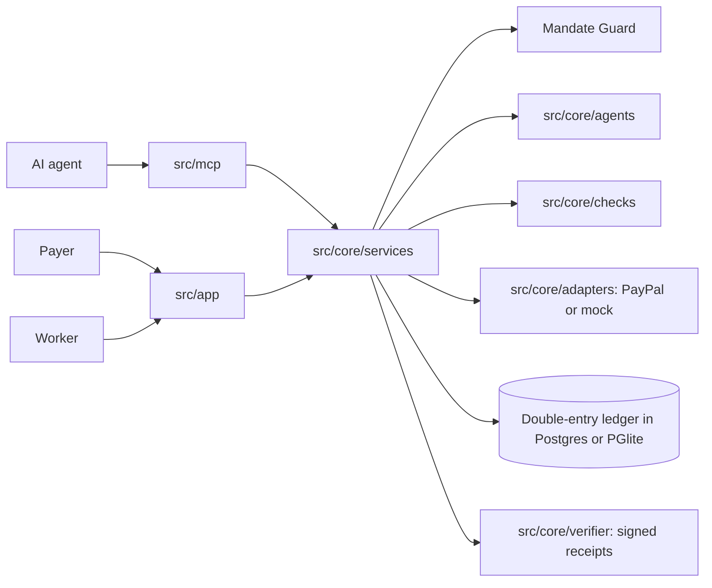

# Architecture

Author: Mokshit Sharma

## Money flow

PayPal has no native escrow here. SettleAI captures to the platform account and tracks a ledgered hold until release or refund.

## Deployment shape

A single Next.js app. `docker-compose.yml` adds Postgres. On the Render free plan it uses embedded PGlite, so the demo restarts fresh.
