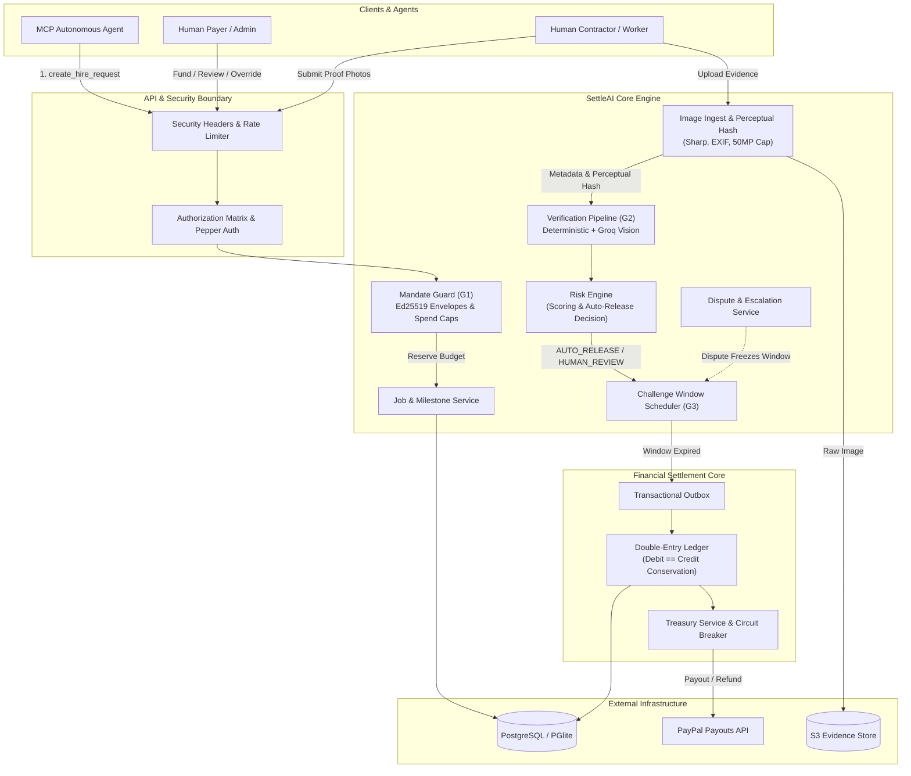

# SettleAI System Design & Architecture

## 1. System Overview
SettleAI provides autonomous escrow, proof verification, and settlement rails for AI agents interacting with real-world contractors and service providers. It decouples LLM agent planning from payment execution via cryptographic mandates, verifiable proof pipelines, and double-entry ledger settlement.

---

## 2. Architecture & Data Flow

---

## 3. Core Component Breakdown

| Component | Responsibility | Failure Behavior & Recovery |
|---|---|---|
| **Mandate Guard (G1)** | Validates canonical Ed25519 envelopes, enforces per-job, daily, and total budget caps, and prevents nonce replay. | Rejects out-of-scope or replayed requests with detailed error reason codes. Zero state modification. |
| **Verification Pipeline (G2)** | Executes dual-track verification: deterministic checks (EXIF timestamp, GPS geofence, perceptual duplicate detection) + LLM vision assessment. | Network failure on Groq LLM degrades gracefully to `HUMAN_REVIEW`. No automatic releases on ambiguous AI outputs. |
| **Risk Engine** | Computes multi-factor risk score (contractor trust history, first-time pairing, geodistance, duplicate flags, prompt injection suspicion). | Critical risk flags force hard `HOLD` or `HUMAN_REVIEW`. |
| **Challenge Window (G3)** | Enforces an escrow holding interval (10m to 48h) allowing payer inspection or dispute filing prior to payout. | Database restart during window preserves pending state; worker catches up missed windows upon recovery. |
| **Double-Entry Ledger** | Enforces immutable financial balance: `debits == credits`, non-negative escrow balances, and exact reconciliation. | Database transaction rollback on constraint violation. Outbox table prevents split-brain states. |
| **Treasury & PayPal Adapter** | Communicates with PayPal Payouts via circuit breaker and retry queues. | Circuit breaker opens on consecutive ECONNRESET / 5xx; payouts queued safely in transactional outbox. |

---

## 4. Failure Mode Matrix

| Failure Mode | User Impact | System Recovery & Mitigation |
|---|---|---|
| **PayPal API Outage (503/Timeout)** | Contractor payout delayed; job shows "Processing Settlement". | Outbox retries with exponential backoff & jitter; funds remain locked in escrow; zero double-payout. |
| **Groq / Vision Model Outage** | Instant auto-approval disabled. | Degrades to `HUMAN_REVIEW`; admin notified via console; contractor advised of manual review. |
| **Database Crash during Challenge Window** | App temporarily offline. | On restart, `processDueWindows()` queries all unreleased milestones whose `releaseDueAt <= now()` and settles them. |
| **Webhook Flood (50+ concurrent requests)** | Webhook response time may increase slightly. | Database unique constraint on `(provider, event_id)` drops duplicates; idempotency lock ensures single posting. |
| **Decompression Bomb (Gigapixel image upload)** | Malicious request rejected with 400 Bad Request. | Pre-decoding metadata check (`limitInputPixels: 50_000_000`, 12 MB max buffer) rejects stream before memory exhaustion. |

---

## 5. Capacity & Scalability Analysis (Back-of-Envelope)

- **Throughput Target:** 150 operations/sec on core API, 50 verification jobs/min.
- **Verification Pipeline:**
  - Image downscale & hash: ~45 ms CPU time.
  - LLM Vision Inference: ~850 ms (via Groq Qwen-2.5-VL / Llama-3.2-Vision).
- **Storage Growth:**
  - Metadata + Ledger entries: ~2.4 KB per job.
  - Evidence images (downscaled JPEG, quality 85): ~320 KB per milestone.
  - At 10,000 jobs/month: ~3.2 GB S3 storage, ~24 MB Postgres records.
- **Cost Estimation per 1,000 Jobs:**
  - ECS Fargate (0.5 vCPU, 1 GB RAM): ~$0.48 / 1,000 requests.
  - S3 Evidence Storage (3.2 GB-month): ~$0.08.
  - Vision LLM API (Groq tokens): ~$0.30 per 1,000 verifications.
  - Total operational infra cost: **<$1.00 per 1,000 settled jobs**.

---

## 6. Service Level Objectives (SLOs)
- **API Availability:** 99.95% uptime.
- **Mandate Guard Evaluation Latency:** p50 < 25 ms, p95 < 60 ms.
- **Evidence Verification Latency:** p50 < 1.2 s, p95 < 2.5 s.
- **Ledger Invariant Enforcement:** 100% (zero violation tolerance: `debit == credit` strictly enforced).
